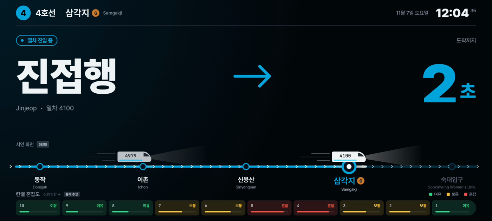
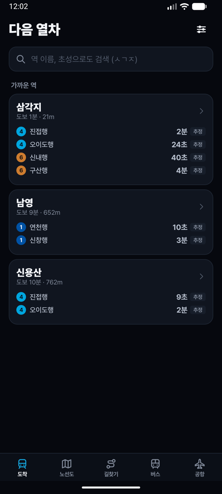
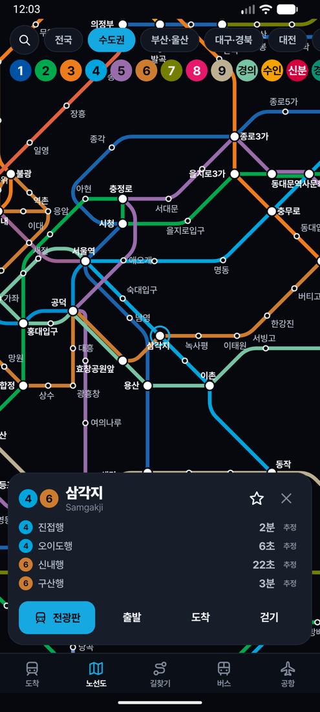
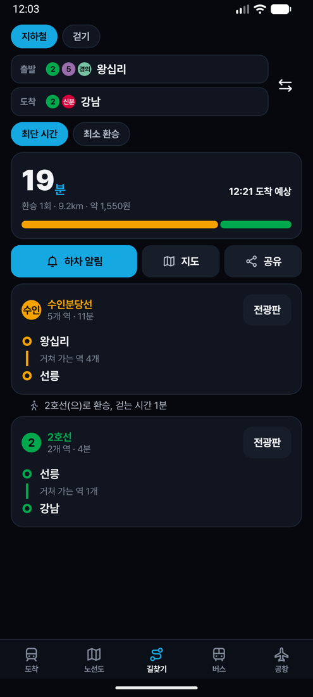
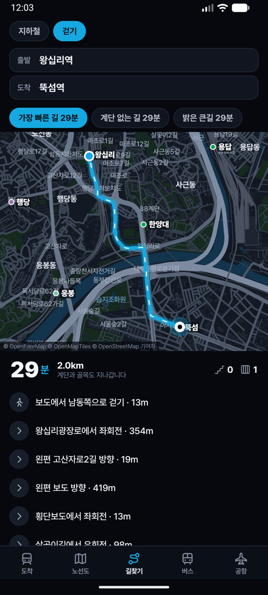
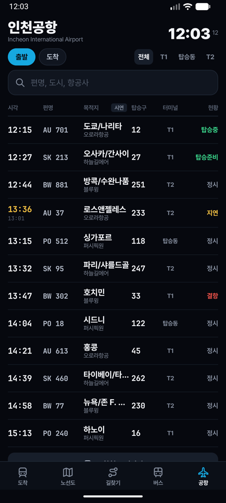

# Ferrite

**[Try it in your browser](https://aetherx86.github.io/ferrite/) · [Download the Android APK](https://github.com/Aetherx86/Ferrite/releases/latest)**

전국 도시철도의 다음 열차, 노선도, 길찾기, 걷기, 공항 전광판, 버스 도착을 한 앱에 담았습니다. Kotlin Multiplatform으로 만들었고 Android, iOS, 웹이 같은 코드로 돌아갑니다.

Next trains, network maps, trip planning, walking directions, an airport flight board and bus arrivals for all of Korea, in one app. Built with Kotlin Multiplatform, so Android, iOS and the web run the same code.



| 도착 | 노선도 | 길찾기 | 걷기 | 공항 |
| --- | --- | --- | --- | --- |
|  |  |  |  |  |

[한국어](#한국어) · [English](#english)

---

## 한국어

### 기능

| 기능 | 내용 |
| --- | --- |
| 역 전광판 | 남은 시간을 크게 보여 주고, 움직이는 열차와 칸별 혼잡도를 함께 표시합니다. 열차가 도착하면 노선 색이 이 역 표시에서 퍼져 화면을 채우고, 접근음, 도착 벨, 문 닫힘 경고음이 납니다. 가로와 세로 화면을 모두 지원합니다. |
| 노선도 | 수도권, 부산, 대구, 대전, 광주 943개 역의 직선 노선도입니다. 확대할수록 역 이름이 겹치지 않는 선에서 더 나타납니다. 노선을 고르면 그 노선만 강조합니다. |
| 전국 지도 | 시도와 시군구 경계, 실제 선로 모양, 간선 철도를 직접 그리는 벡터 지도입니다. |
| 길찾기 | 최단 시간과 최소 환승 경로를 인터넷 없이 찾습니다. 운영기관이 측정한 환승 거리와 수도권 거리 비례 요금을 반영합니다. 하차 알림과 경로 공유를 지원합니다. |
| 걷기 | 가장 빠른 길, 계단 없는 길, 밝은 큰길을 비교합니다. 계단과 횡단보도 수, 턴별 안내, 가까운 역 출구 번호를 보여 줍니다. |
| 공항 | 인천공항 출발과 도착 전광판입니다. 터미널 필터, 편명과 도시 검색, 지연과 결항 표시를 지원합니다. |
| 버스 | 주변 정류장과 도착 정보입니다. 서울은 서울시 서비스, 그 밖의 도시는 국가대중교통정보센터 서비스를 사용합니다. |
| 검색과 저장 | 초성 검색(ㅅㄱㅈ으로 삼각지), 즐겨찾기, 최근 역, 내 주변 역을 지원합니다. |

### 무엇이 실시간이고 무엇이 추정인가

화면의 표시가 데이터의 출처를 항상 알려 줍니다.

| 표시 | 뜻 |
| --- | --- |
| `LIVE` | 운영기관이 방금 보고한 열차 정보입니다. 수도권 전철에서 서울 열린데이터광장 키를 넣으면 나옵니다. |
| `추정` | 노선의 평소 배차 간격으로 계산한 값입니다. 키가 없거나 공개 실시간 정보가 없는 도시에서 나옵니다. 실제 열차와 다를 수 있습니다. |
| `DEMO`, `시연` | 대본대로 움직이는 예시 데이터입니다. 항공사 이름도 가상입니다. 웹 체험판은 브라우저 보안 규칙 때문에 전광판, 공항, 버스가 이 상태로 움직입니다. |
| `통계 추정` | 칸별 혼잡도입니다. 칸별 혼잡을 공개하는 무료 정보는 없습니다. 서울교통공사의 30분 단위 평균 혼잡도에, 계단 가까운 칸이 더 붐비는 일반적인 모양을 입힌 추정치입니다. |

노선도, 길찾기, 걷기, 공항 키 입력 화면 등 나머지는 실제 데이터로 동작합니다. 걷기는 인터넷이 필요합니다.

### 실시간 키 넣기

키는 무료이고 기기에만 저장됩니다. 앱의 설정 화면에 붙여 넣으면 됩니다.

| 키 | 받는 곳 | 쓰는 곳 |
| --- | --- | --- |
| 실시간 지하철 인증키 | [서울 열린데이터광장](https://data.seoul.go.kr/dataList/OA-12764/F/1/datasetView.do) | 수도권 전철 전광판 |
| 일반 인증키 | [공공데이터포털](https://www.data.go.kr/data/15095093/openapi.do) | 공항 운항, 버스 도착 |

버스 도착은 공공데이터포털에서 서울 버스와 국가대중교통정보센터 서비스를 각각 신청해야 합니다.

### Android 설치

[최신 릴리스](https://github.com/Aetherx86/Ferrite/releases/latest)에서 `Ferrite-버전.apk`를 받아 설치합니다. Android 8.0 이상이 필요합니다. 처음이면 출처를 알 수 없는 앱 설치를 허용해야 합니다. 함께 올라가는 `SHA256SUMS`로 파일을 검증할 수 있습니다.

### Android 에뮬레이터에서 직접 빌드

```bash
./gradlew :androidApp:installDebug
```

JDK 21 이상과 Android SDK 37이 필요합니다. 빠르게 보려면 `:androidApp:installRelease`를 쓰세요. 서명 키를 지정하지 않으면 디버그 키로 서명합니다.

### iPhone과 iPad

iOS는 패키지를 배포하지 않습니다. 이 저장소의 파일로 직접 빌드합니다.

1. Mac에 Xcode와 JDK 21 이상을 설치합니다.
2. `iosApp/iosApp.xcodeproj`를 Xcode로 엽니다.
3. Signing & Capabilities에서 본인의 Team을 고릅니다. 다른 사람이 쓰던 번들 ID와 겹치면 `dev.aetherx86.ferrite`를 본인 것으로 바꿉니다.
4. 실행 대상으로 기기나 시뮬레이터를 고르고 Run을 누릅니다. 첫 빌드는 공용 코드를 컴파일하느라 몇 분 걸립니다.

App Store나 TestFlight로 배포하려면 Apple Developer Program에 가입한 뒤 Xcode에서 Product, Archive, Distribute App 순서로 진행합니다. 위치 권한 문구와 평문 HTTP 예외는 `iosApp/iosApp/Info.plist`에 있으며, 예외는 HTTP만 지원하는 공공 서비스 두 곳으로 한정했습니다. 심사 때 이 사유를 적어 주세요.

Xcode가 JDK를 찾지 못하면 빌드 전에 `JAVA_HOME`을 Xcode 스킴의 환경 변수나 `~/.zshenv`에 넣으세요.

### 웹 체험판 빌드

```bash
./gradlew :shared:wasmJsBrowserDistribution
```

결과물은 `shared/build/dist/wasmJs/productionExecutable`에 생기며 정적 호스팅에 그대로 올릴 수 있습니다. 주소에 `?station=삼각지&line=S4`, `?tab=map`, `?walkFrom=왕십리&walkTo=뚝섬`을 붙이면 해당 화면으로 바로 열립니다.

### 알아 둘 점

- 실시간 지하철과 서울 버스 서비스는 HTTP만 지원합니다. 앱은 이 두 곳에만 평문 통신을 허용하며, 키가 암호화되지 않고 전송됩니다.
- 공항과 버스 연동은 공개 명세와 예시로 작성해 테스트했지만, 키가 없어 실제 서버로는 시험하지 못했습니다. 실시간 지하철은 공개 시험 키의 실제 응답으로 검증했습니다.
- 걷기는 공개 경로 서버를 쓰고, 연결되지 않으면 공개 지도 서버에서 길을 받아 기기에서 직접 계산합니다. 공개 서버라 붐빌 수 있습니다.
- 하차 알림은 시간 기준이며 앱이 켜져 있어야 합니다. 지하에서는 위치를 알 수 없기 때문입니다.
- 요금은 수도권 거리 비례 규칙으로 계산한 참고값이며, 다른 도시는 표시하지 않습니다. 소요 시간도 역간 거리로 추정한 값입니다.

---

## English

### Features

| Feature | What it does |
| --- | --- |
| Platform board | The wait in large type, with trains moving along the line and a load estimate for each car. When a train arrives, the line's color spreads from this station's marker across the page, with an approach chime, arrival bell and door warning. Works in both orientations. |
| Network maps | Octilinear maps of 943 stations in the capital area, Busan, Daegu, Daejeon and Gwangju. Station names appear as you zoom, only when they have room. Picking a line highlights it. |
| National map | A vector map drawn by the app: province and municipality borders, real track shapes and intercity rail. |
| Trip planning | Fastest and fewest-change routes, computed on the device with no connection. Uses the operator's measured transfer walks and the capital area's distance fares. Includes a get-off alert and sharing. |
| Walking | Compares the fastest, step-free and well-lit routes. Shows stairs and crossings, turn-by-turn directions, and the nearest station exit. |
| Airport | Incheon departures and arrivals, with terminal filters, search by flight or city, and delays and cancellations marked. |
| Bus | Nearby stops and arrivals, from Seoul's service in Seoul and the national transit center elsewhere. |
| Search and saving | Search by initial consonants (`ㅅㄱㅈ` finds 삼각지), favorites, recent stations, stations near you. |

### What is live and what is estimated

A tag on screen always says where the numbers come from.

| Tag | Meaning |
| --- | --- |
| `LIVE` | Reported by the operator just now. Appears on capital area lines once you add a Seoul open data key. |
| `추정` (estimate) | Worked out from how often the line usually runs. Appears with no key, and in cities with no public live feed. A real train may differ. |
| `DEMO`, `시연` | Scripted sample data, with fictional airline names. In the web edition, browser security rules keep boards, the airport and buses in this state. |
| `통계 추정` (statistical estimate) | The per-car load. No free public source reports this. It combines the operator's half-hourly average for the station with the usual shape of a train, fuller near the stairs. |

Everything else, including maps, trip planning and walking, runs on real data. Walking needs a connection.

### Live data keys

Keys are free, stay on the device, and go in the app's settings screen.

| Key | Where | Used for |
| --- | --- | --- |
| Realtime subway key | [Seoul Open Data Plaza](https://data.seoul.go.kr/dataList/OA-12764/F/1/datasetView.do) | Capital area boards |
| General key | [Korean open data portal](https://www.data.go.kr/data/15095093/openapi.do) | Flights and buses |

For buses, apply for the Seoul bus and national transit center services separately on the portal.

### Install on Android

Get `Ferrite-version.apk` from the [latest release](https://github.com/Aetherx86/Ferrite/releases/latest). It needs Android 8.0 or later, and you may have to allow installs from unknown sources. `SHA256SUMS` in the same release verifies the file.

### Build for Android or an emulator

```bash
./gradlew :androidApp:installDebug
```

This needs JDK 21 or later and Android SDK 37. `:androidApp:installRelease` runs much faster, and signs with the debug key if no signing key is set.

### iPhone and iPad

There is no prebuilt iOS package. You build it from these files.

1. Install Xcode and JDK 21 or later on a Mac.
2. Open `iosApp/iosApp.xcodeproj` in Xcode.
3. Under Signing & Capabilities, pick your team. If the bundle ID is taken, change `dev.aetherx86.ferrite` to your own.
4. Choose a device or simulator and press Run. The first build takes a few minutes to compile the shared code.

To distribute through the App Store or TestFlight, join the Apple Developer Program, then use Product, Archive and Distribute App in Xcode. The location prompt and the plain HTTP exceptions are in `iosApp/iosApp/Info.plist`. The exceptions cover only the two public services that have no HTTPS, which is worth stating in App Review notes.

If Xcode cannot find a JDK, set `JAVA_HOME` in the scheme's environment or in `~/.zshenv`.

### Build the web edition

```bash
./gradlew :shared:wasmJsBrowserDistribution
```

The output in `shared/build/dist/wasmJs/productionExecutable` can go on any static host. Adding `?station=삼각지&line=S4`, `?tab=map` or `?walkFrom=왕십리&walkTo=뚝섬` opens that screen directly.

### Limits

- The realtime subway and Seoul bus services only speak HTTP. The app allows plain traffic to those two hosts and no others, and keys travel unencrypted to them.
- The airport and bus integrations are written and tested against published specifications and samples, not a live server, for lack of a key. The subway feed was checked against real answers from its public sample key.
- Walking uses a public routing service, and if that is unreachable, downloads the streets from a public map server and routes on the device. Public servers can be busy.
- The get-off alert goes by the clock and needs the app open, since there is no location underground.
- Fares follow the capital area's distance rules and are a guide. Other cities show none. Travel times are estimated from station spacing.

## How it is built

| Part | What it does |
| --- | --- |
| `shared/src/commonMain` | All screens and logic, in Kotlin with Compose Multiplatform |
| `shared/src/androidMain`, `iosMain`, `wasmJsMain` | Network, sound, location and storage for each platform |
| `androidApp`, `iosApp` | Thin app wrappers |
| `tools/` | The data pipeline, in Python |

The maps are generated, not traced. `tools/extract_lines.py` turns open rail data into one clean graph per line and removes the jumps left by express services. `tools/layout_schematic.py` evens out station spacing with stress majorization, then routes each run of track across an octilinear grid with bends priced in, and improves the result with local search. `tools/build_geo.py` and `tools/build_network.py` write the files the app loads. Sounds are synthesized in code, so there are no recordings.

Run the tests with:

```bash
./gradlew :shared:testAndroidHostTest
```

They include checks against things anyone can verify on a real map, such as station counts per line and which lines meet at an interchange.

## Versioning

Bug fixes bump the third number, and performance improvements or critical fixes bump the second. See [CHANGELOG.md](CHANGELOG.md), and [NOTICE.md](NOTICE.md) for data and font licenses. The code is under the MIT license.
